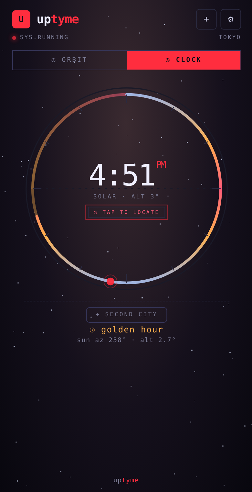
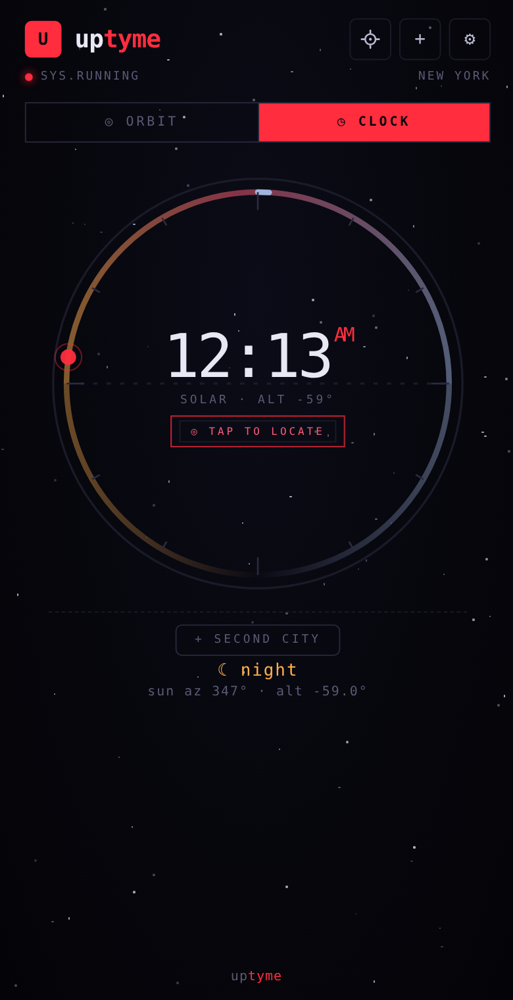
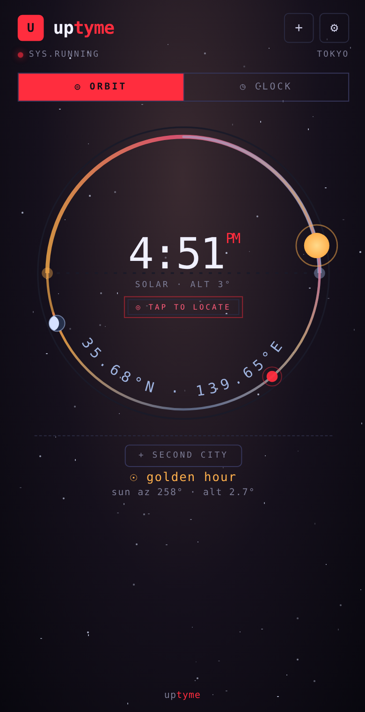
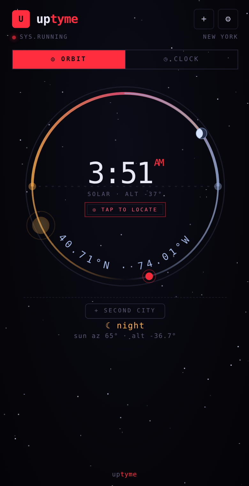

<div align="center">

# ⌚ uptyme

### A clock that shows your time, wherever you are on Earth.

*No accounts, no sign-up, no ads — and your exact location never leaves your device.*

**▶ Open it — [codereimagine.github.io/uptyme](https://codereimagine.github.io/uptyme/)**

<sub><b>CLOCK</b> — a classic dial</sub>
<p>
  
  
</p>
<sub><b>ORBIT</b> — time wrapped around your horizon</sub>
<p>
  
  
</p>

<sub>By <b>Bert Peters</b> · the <b>time</b> axis of <a href="https://github.com/codereimagine">codereimagine</a></sub>

</div>

---

## 🕐 What is it?

uptyme is a clock. It shows your **local time**, big and clear, anywhere on Earth — as a classic **Clock** dial or an **Orbit** ring, your pick. Pin a second city to keep another place's time beside it too.

No app store, no account, nothing to sign up for. Open the link and it works. Like it? Add it to your home screen like any other app.

## ✨ How we do things differently

Most apps want your account, your data, and your attention. Every codereimagine app is built the other way round:

- **Private by default** — no accounts, no tracking, nothing sold. Your exact location stays on *your* device.
- **No ads, no clutter** — nothing on the screen is trying to sell you something.
- **Yours to keep** — installs like an app and keeps working offline, even on a weak signal.
- **Fully open & free** — the whole thing is public (Apache-2.0). Nothing hidden.
- **Made to feel good** — an everyday tool should be beautiful, not just functional.

## 👀 What you can do with it

- **Tell the time, anywhere** — your local time, big and clear, as the headline.
- **Pick your face** — *Clock* (a classic dial) or *Orbit* (the time wrapped around your horizon). One tap.
- **Pin a second city** — keep another place's time beneath the face, always DST-correct.
- **Anywhere** — fast on phones and computers.

## 🛠️ Run or build it yourself (developers)

```bash
git clone https://github.com/codereimagine/uptyme.git
cd uptyme && npm install
npm run dev        # local dev server
npm run build      # production build → dist/
npm run preview    # preview the production build
npm test           # unit tests (incl. the Meeus/NOAA verification)
```

<details><summary><b>🔧 Under the hood</b></summary>

- **Sun & moon:** NOAA Solar Position Algorithm and Meeus methods, computed on-device in `src/engine.ts` — no servers, verified against the reference harness it ports from.
- **Location:** browser geolocation, **tap-gated and in-memory only** — never stored, never reverse-geocoded; Greenwich (the zero meridian) as a graceful fallback. Pinned cities are saved on your device only.
- **Timezones:** the device's `Intl.DateTimeFormat` for your place; searched cities carry their own IANA zone, so the readout stays DST-correct.
- **City search:** [Open-Meteo geocoding](https://open-meteo.com/en/docs/geocoding-api), keyless — the only outbound call in the whole app, and only when you type it.
- **Stack:** React 18 · TypeScript · Vite · `vite-plugin-pwa` (Workbox) · Vitest.

</details>

## 🙌 Credits & thanks

Built with [Claude Code](https://claude.com/claude-code). Nothing here is hidden — uptyme stands on:

- **Geocoding** — [Open-Meteo](https://open-meteo.com) (CC BY 4.0).
- **Astronomy** — sun and moon from Jean Meeus, *Astronomical Algorithms*, and the NOAA Solar Position methods.
- **Emoji** — standard Unicode, drawn by your device.

## 📄 License

Apache-2.0 — see [LICENSE](LICENSE).
